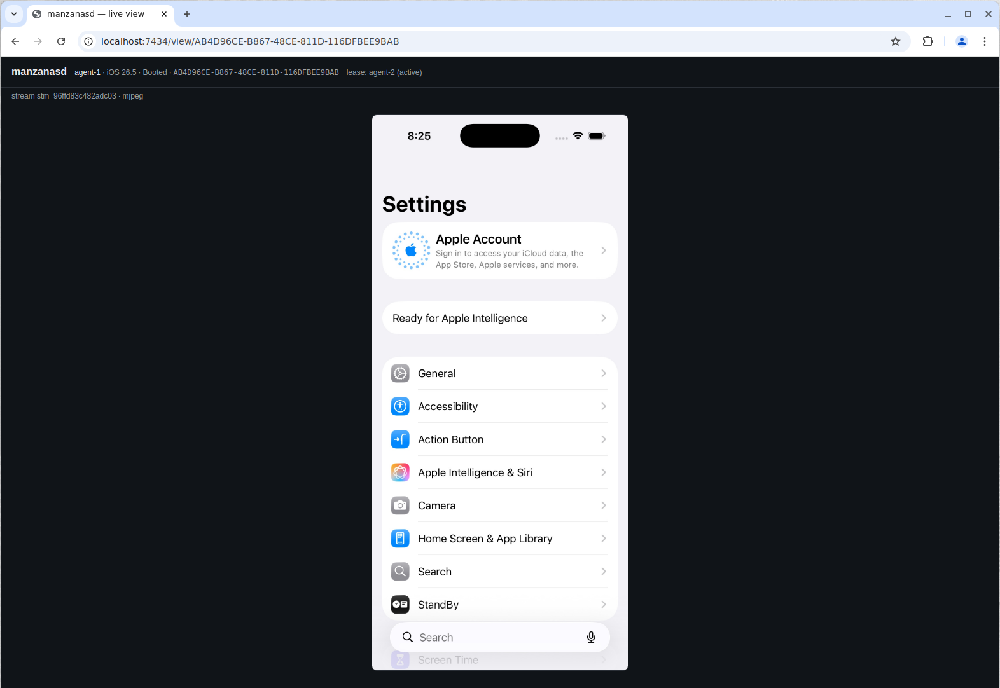
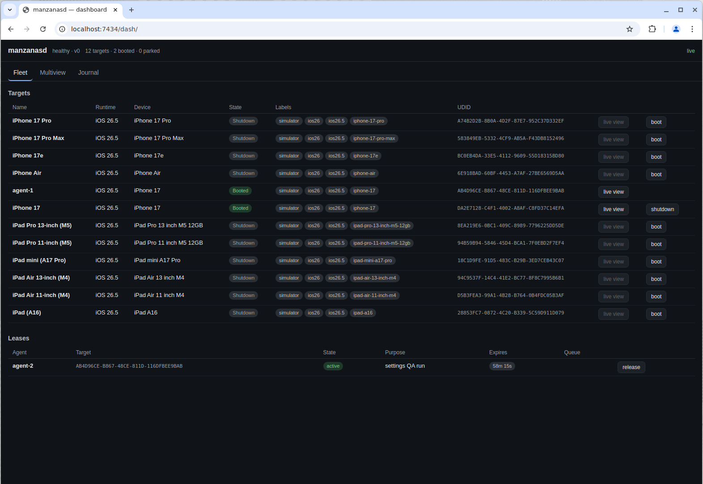

# manzanas

[](https://github.com/BariBariGood/manzanas/releases)
[](https://www.npmjs.com/package/manzanasd-client)
[](https://github.com/BariBariGood/manzanas/actions/workflows/ci.yml)
[](https://allmcps.com/mcp/manzanas?verify=cc5ceeeb-24c5-4ac5-9327-f57ad5eb1165)

A Mac daemon for multi-agent iOS simulator fleet orchestration: leases,
actions, streaming, deterministic state, and an exportable run journal for
AI agents (and humans) sharing simulators.

**The 90% story: lease a simulator, run a YAML spec, get evidence.**
Everything else, fleets, physical phones, mirroring, is an opt-in
chapter you can ignore until you need it.


https://github.com/user-attachments/assets/deb577d0-1123-4a89-90d8-8d9c7684a3cf


*The launch film, leases, actions, live streaming, warm pools, the broker,
and the run journal in 52 seconds. Sound on.*

`manzanasd` runs on each Mac host and owns everything stateful, the
simulator registry, the lease table, the warm pool, action backends,
streamers, golden images, and the run journal. Clients (`manzanas` CLI, MCP
facade, SDKs) are thin and cross-platform, speaking a versioned JSON
protocol over HTTP + WebSocket.

**Website: [manzanas.dapsdev.dev](https://manzanas.dapsdev.dev)** (source in
[`site/`](site/)).

## Five-minute quickstart

No flags to read, no config to write. Four layers, start at whichever
matches your machine:

### 0. One-liner (macOS/Linux): npx

```sh
npx manzanasd-client@latest doctor   # downloads the release binary and runs the setup diagnosis
```

The npm wrapper fetches the right `manzanasd`/`manzanas` binary for your
platform on install, then proxies every command to it. Use it as the CLI,
or point your agent's MCP config at `manzanas mcp`.

### 1. Anywhere (no Mac): mock mode

```sh
make build                      # writes bin/manzanasd, bin/manzanas, bin/manzanas-broker
./bin/manzanasd --mock          # full daemon + fake fleet + mock action backend
```

In another terminal, run the whole lease → boot → act → evidence loop as
one declarative YAML run:

```yaml
# hello.yaml, drives the mock login screen (docs/mock.md)
name: hello
target:
  labels: [ios26]
steps:
  - action: type_into_element
    with: {id: username, text: agent}
  - action: type_into_element
    with: {id: password, text: pw}
  - action: tap_element
    with: {label: "Sign In"}
  - action: wait_for_element
    with: {label: "Welcome, agent!", timeout_ms: 5000}
```

```sh
./bin/manzanas run hello.yaml -o evidence.md
cat evidence.md                 # PR-ready markdown evidence of every step
```

That's the product: one spec, one command, a journaled evidence trail.
The same spec runs unchanged against real simulators, and against
physical phones, because every target speaks the same actions API.

### 2. On a Mac with Xcode: real simulators

```sh
brew tap baribarigood/tap https://github.com/BariBariGood/homebrew-tap
brew trust baribarigood/tap      # Homebrew >= 6 requires trusting third-party taps
brew install manzanasd            # daemon (+ pulls in the manzanas CLI)
brew services start manzanasd     # launchd service on port 7433
manzanas doctor                   # one-shot setup diagnosis; every failure names its fix
```

`manzanasd` needs **zero flags** for a working single-Mac daemon:
sensible defaults for the journal, template library, and element map,
simulators enumerated from `simctl`, physical devices and the mirror off
until you opt in. The same `manzanas run spec.yaml` now drives real
simulators. Step-by-step walkthrough (lease, tap, screenshot, release by
hand): [docs/quickstart.md](docs/quickstart.md).

```sh
manzanas targets                                        # list simulators
manzanas lease acquire --labels ios26 --agent me --wait # claim one
manzanas tap 200 400 --lease lse_...                    # drive it
manzanas mcp                                            # or hand the tools to an agent
```

### 3. Optional chapters (you probably don't need these yet)

- **Physical iPhones** (WebDriverAgent): [docs/devices.md](docs/devices.md)
- **XCTest-hostile apps** via iPhone Mirroring:
  [docs/mirror-onboarding.md](docs/mirror-onboarding.md)
- **Multiple Macs behind one endpoint**: [docs/broker.md](docs/broker.md)

## Why

Agents driving simulators over raw SSH + CLI tools trip over each other
and pay huge fixed costs. manzanasd removes both, with measured numbers
(M3 Pro, macOS 26.5, Xcode 26.5; reproduce with `make bench`):

- **Leases, not locks**: TTL-bounded exclusive claims with FIFO queues, no two agents ever drive the same sim.
- **Park/thaw warm pool**: idle sims are SIGSTOPped (a parked tree is
  unschedulable, ~0 idle host CPU no matter what the sim's daemons are
  doing) and thawed on lease grant: **~0.28 s lease-to-live vs ~7 s for a
  cold boot** (~29 s first boot). The thaw itself is a cached-PID SIGCONT
  and takes under a millisecond.
- **Warm actions**: a resident per-sim helper makes an end-to-end tap
  **~36 ms vs ~950 ms** cold (per-action AXe spawn), ~3 s cold on Intel.
- **Deterministic state**: snapshots, fixtures, per-lease auto-reset, and
  golden images that stamp out slimmed sims in seconds (**~0.75 GB vs
  ~5 GB stock**, via [simslim](https://github.com/MobAI-App/simslim)), how one Mac runs a dozen sims.
- **Evidence**: every mutating op under a lease is journaled, with
  content-addressed artifacts and a PR-ready markdown export.

| | |
|---|---|
| Leases | TTL-bounded exclusive claims, labels, FIFO queues, auto-reset, pause/resume for human handoff |
| Warm pool | park/thaw (SIGSTOP) pool sims: ~0.28 s lease-to-live, ~0 idle CPU |
| Actions | cold (AXe) + warm (resident helper) taps/swipes/typing, composite `tap_element` with a structured predicate DSL, list-scrolling composites (`scroll_until`/`scroll_collect`), pixel templates (`save_template`/`tap_template`), batches |
| Verification | `assert_text`/`assert_template` postconditions, opt-in pixel-verified taps, `wait_for_stable` pixel settle, run verdicts + replay drift detection |
| Runs | one-call YAML runs: lease → boot → app → steps → evidence → release ([docs/runs.md](docs/runs.md)) |
| Audit | deterministic UI checks (touch targets, clipping, alignment, spacing, safe area, missing labels) → findings + annotated screenshot in the journal |
| Streaming | MJPEG fan-out, browser [`/view` page](docs/assets/live-view.png), WS frames |
| Video | per-lease `simctl` recordings that land in the journal |
| State | snapshots, fixtures, per-lease auto-reset, golden images |
| Journal | append-only evidence per run, artifacts, `export.md`, replayable spec export |
| Dashboard | read-only [web dashboard](docs/assets/dashboard.png) at `/dash`: fleet, leases, multiview, journal browser |
| Doctor | `manzanas doctor`: one-shot host diagnosis, every failing check carries its fix |
| Devices | physical iPhones via devicectl + WebDriverAgent, or iPhone Mirroring for XCTest-hostile apps |
| Fleet | `manzanas-broker` federates N Macs behind one endpoint |
| Clients | `manzanas` CLI, MCP tools over stdio, npm wrapper, GitHub Action |

|  |  |
|---|---|
| the browser `/view` MJPEG live page | the built-in `/dash` fleet dashboard |

https://github.com/user-attachments/assets/983b0548-df1a-41a3-812c-f0f39cfaa01c

*1 orchestrator, 7 Codex agents, 7 simulators across 3 Macs, leases mean
nobody trips over anybody. Real time, no edits.*

## MCP (Claude Code, Cursor, Codex)

`manzanas mcp` serves the whole toolset over the Model Context Protocol
(stdio), so any MCP-capable agent can lease and drive simulators, with
per-session auto-release of leases and self-describing tool errors.
Ready-to-paste client configs and troubleshooting:
[docs/mcp.md](docs/mcp.md).

```sh
claude mcp add manzanas -e MANZANASD_ADDR=mac-host:7433 -- /path/to/manzanas mcp
```

## Architecture

```
┌ Linux / CI / anywhere ────────────┐        ┌ each Mac host ─────────────────────────────┐
│ manzanas (thin client, Go)         │   WS   │ manzanasd (Go daemon)  :7433                │
│  - CLI: lease/tap/observe/...     │◄──────►│  registry ── warm pool (park/thaw, gates)  │
│  - MCP facade (stdio)             │  HTTP  │  leases (TTL, labels, FIFO, auto-reset)    │
│  - eval harness (manzanas-eval)    │        │  actions ── cold AXe / warm simbridge      │
├───────────────────────────────────┤        │  streams (MJPEG fan-out, browser view)     │
│ manzanas-broker  :7440             │        │  state (snapshots, fixtures, golden images)│
│  fleet-wide placement: leases are │───────►│  journal (evidence, artifacts, export.md)  │
│  scheduled across N daemons, then │ probe/ └────────────────────────────────────────────┘
│  clients talk to the owning       │ lease         × one daemon per Mac in the fleet
│  daemon directly (host_addr)      │
└───────────────────────────────────┘
```

One orchestration core, transports as thin backends: the same YAML spec,
leases, journal, and evidence pipeline run against simulators
(AXe/simctl), physical iPhones (WebDriverAgent), and XCTest-hostile apps
(iPhone Mirroring). What manzanas is *not*, a generic OCR automation
framework, an app-botting tool, is written down in
[docs/non-goals.md](docs/non-goals.md), along with why the repo stays
one repo.

## Documentation

**Start here** (the 90% path):

- [docs/quickstart.md](docs/quickstart.md), zero to a passing run on
  one Mac: install → doctor → lease → tap → screenshot → YAML run.
- [docs/runs.md](docs/runs.md), the one-call YAML run: schema, verdicts,
  drift detection, record → replay.
- [docs/mock.md](docs/mock.md), the full daemon anywhere (Linux/CI), no
  Mac needed.
- [docs/journal.md](docs/journal.md), the evidence trail: run journal
  format, artifacts, markdown export, replayable spec export.
- [docs/mcp.md](docs/mcp.md), handing the tools to an agent (Claude
  Code, Cursor, Codex).
- [docs/troubleshooting.md](docs/troubleshooting.md), `manzanas doctor`
  first, then symptoms → causes → fixes.

**Going deeper** (read when you hit the subsystem):

- [proto/PROTOCOL.md](proto/PROTOCOL.md), the v0 wire protocol: targets,
  leases, actions, streams, state, journal, runs, WS surface. The tables
  in §5 are the authoritative list of action kinds and payloads.
- [docs/architecture.md](docs/architecture.md), components, interface
  contracts, and the product boundary.
- [docs/agent-qa.md](docs/agent-qa.md), a worked end-to-end agent QA
  session, plus driving animated (React Native) apps.
- [docs/resolver-ladder.md](docs/resolver-ladder.md), how element
  resolution works: map/ax/ocr/template rungs, provenance, escalation.
- [docs/elementmap.md](docs/elementmap.md), the learned element map
  (fast-path resolution across runs).
- [docs/templates.md](docs/templates.md), the pixel-template library
  (`save_template` / `tap_template` / `assert_template`).
- [docs/warm-pool.md](docs/warm-pool.md), park/thaw warm pool, footprint
  watchdog, host safety gates.
- [docs/actions-warm.md](docs/actions-warm.md), warm vs cold action
  paths; the resident `simbridge` helper.
- [docs/state.md](docs/state.md), snapshots, fixtures, per-lease
  auto-reset, quarantine.
- [docs/images.md](docs/images.md), golden images: slim once, stamp N
  sims in seconds.
- [docs/streaming.md](docs/streaming.md), MJPEG streaming and the
  browser view page.
- [docs/dashboard.md](docs/dashboard.md), the built-in read-only web
  dashboard at `/dash`.
- [docs/recording.md](docs/recording.md), per-lease video capture into
  the journal.
- [docs/eval.md](docs/eval.md), the scenario-driven determinism
  benchmark harness.
- [clients/README.md](clients/README.md), `manzanas` CLI + MCP
  quickstarts; [clients/npm/](clients/npm/README.md); GitHub Action in
  [action/](action/README.md).

**You probably don't need these yet** (opt-in surfaces; each page opens
with who it's for):

- [docs/non-goals.md](docs/non-goals.md), the product boundary: what
  manzanas is, what it deliberately is not, and the one future split
  candidate.
- [docs/devices.md](docs/devices.md), physical iPhones as leasable
  targets (devicectl + WebDriverAgent), and the mirror backend reference.
- [docs/mirror-onboarding.md](docs/mirror-onboarding.md), the guided
  setup path for driving XCTest-hostile apps through iPhone Mirroring.
- [docs/broker.md](docs/broker.md), multi-Mac federation.
- [docs/fleet.md](docs/fleet.md), running a multi-Mac fleet (topology,
  Tailscale, day-2 ops).
- [docs/install.md](docs/install.md), launchd install, releases,
  Homebrew formula.

The physical fleet this runs on (machines, locks, build caching) is
site-specific; [docs/fleet.md](docs/fleet.md) covers the daemon's part.

## Status

Everything above is implemented and running on the fleet, leases +
queues (incl. pause/resume), warm pool with safety gates, cold (AXe) +
warm (simbridge) action backends, composite/batch/assert actions, the
resolver ladder with element map and pixel templates, one-call YAML runs
with verdicts and drift detection, MJPEG streaming, video capture,
snapshots/fixtures/auto-reset, golden images, journal, dashboard, doctor,
physical-device support (WDA + mirror), broker, eval harness, CLI + MCP.
Verify with `go build ./... && go vet ./... && go test ./...`
(Linux-safe; simctl paths are mocked).

## License

Apache-2.0, see [LICENSE](LICENSE). Releases up to and including v0.6.0
(and their existing tags) were published under MIT and remain MIT; later
releases are Apache-2.0.
